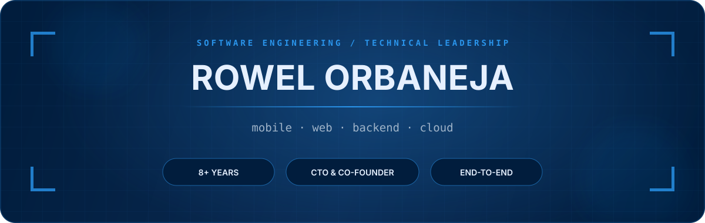

<p align="center">
  
</p>

<p align="center">
  <a href="https://github.com/ruruorbz"></a>
  <a href="https://linkedin.com/in/rowelorbaneja"></a>
  <a href="mailto:rowelorbaneja@gmail.com"></a>
  <a href="https://github.com/ruruorbz/portfolio-web-app"></a>
</p>

I’m a senior software engineer, technical leader, and startup co-founder with 8+ years of experience taking mobile, web, and backend platforms from architecture to production. My work sits where product requirements become dependable systems: clear technical direction, scalable APIs, thoughtful client applications, and the infrastructure that keeps them running.

As CTO & Co-Founder of **Heltsync**, I lead the technical direction of a healthcare technology platform spanning React Native applications, backend architecture, cloud infrastructure, delivery pipelines, and security.

<table>
  <tr>
    <td width="50%" valign="top">
      <h3>What I build</h3>
      Cross-platform mobile products, modern web applications, secure REST APIs, real-time features, authentication systems, and role-based platforms.
    </td>
    <td width="50%" valign="top">
      <h3>How I work</h3>
      I translate business needs into production-ready solutions, then support them with architecture reviews, code reviews, delivery planning, and pragmatic engineering standards.
    </td>
  </tr>
</table>

## Selected work

| Product | What it does | Selected technologies |
| :--- | :--- | :--- |
| **Heltsync** | A health and veterinary services platform for virtual consultations, prescriptions, medication planning, and medical records across individuals, families, employees, and pets. | React Native, Expo, TypeScript, Node.js, Express, PostgreSQL, Socket.IO, AWS |
| **NuLes** | A driving education platform that brings lesson scheduling, learner progress, homework, invoicing, payments, and messaging into one system. | React Native, Expo, TypeScript, Node.js, Express, PostgreSQL, Socket.IO, Jest |
| **Sinking Web App** | A group savings and lending platform with contribution tracking, penalties, loan workflows, reservations, dividend distribution, and fund-health reporting. | Next.js, React, TypeScript, Tailwind CSS, Firebase, Recharts |
| **Scoliosis Philippines** | A member app for registration, resources, advocacy, awareness efforts, and community support. | React Native, Expo, Firebase, social authentication |

> Product repositories and live URLs are not listed because the portfolio does not publish verified links for them.

## Technical range

<table>
  <tr>
    <td valign="top"><strong>Client applications</strong><br/><br/>React Native · Expo · React · Next.js · TypeScript · JavaScript · Android (Java/Kotlin)</td>
    <td valign="top"><strong>Backend & data</strong><br/><br/>Node.js · Express · PostgreSQL · MySQL · MongoDB · Firebase · Sequelize · REST APIs</td>
  </tr>
  <tr>
    <td valign="top"><strong>Cloud & delivery</strong><br/><br/>AWS · Cloudflare · Docker · GitHub Actions · CI/CD · cloud storage</td>
    <td valign="top"><strong>Systems & practice</strong><br/><br/>Authentication · RBAC · API integrations · unit/integration testing · Agile · Scrum · Kanban</td>
  </tr>
</table>

## Experience snapshot

```text
2025 — now   Heltsync                     CTO & Co-Founder
2025 — 2026  NuLes                       Senior Software Developer
2021 — 2024  Accenture                   Software Development Senior Analyst
2018 — 2021  KYOCERA Document Solutions  Software Developer
```

Across these roles, I’ve led end-to-end platform development, supported enterprise Android API integrations, built productivity and automation tools, and delivered mobile and internal web applications. My work at Accenture earned multiple **LIKHA recognitions** for innovation, technical excellence, and organizational impact.

## Beyond the code

I care about the less-visible parts of software: maintainable boundaries, reliable deployments, observability, backups, and security. I’m at my best when I can connect those engineering details to a real product need—and help a team make sound decisions along the way.

<p align="center">
  <strong>Open to new opportunities and thoughtful technical conversations.</strong><br/>
  <sub>Reach me through <a href="mailto:rowelorbaneja@gmail.com">email</a> or connect on <a href="https://linkedin.com/in/rowelorbaneja">LinkedIn</a>.</sub>
</p>

<p align="center">
  <sub>Designed around the deep-blue blueprint language of my portfolio.</sub>
</p>
